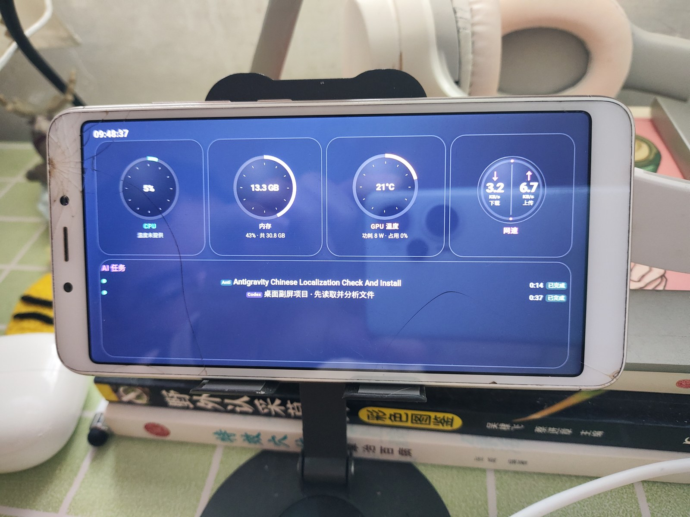

# Phone AI Monitor · Desk Side Display (Local Enhanced Edition)

[简体中文](README.md) | **English**

> An unofficial modified version of [kdwbll/desk-side-display](https://github.com/kdwbll/desk-side-display). The upstream project is MIT-licensed; this repository keeps the original copyright notice and is released under the MIT License.
>
> This edition runs from Windows source and **does not ship a prebuilt EXE**. It turns an idle Android phone into a second small display for your desktop: lyrics, hardware monitoring, AI task status, clock, photo frame, and custom widgets. It can also trigger a few local actions from the phone.



# For humans

## What this project is for

Many people have an idle Android phone, but no room on the desk for a second monitor. This project turns the phone into a small screen that starts with your PC and connects over USB or your local network. No phone app is required, and no data is uploaded to the cloud.

- **Desktop lyrics and album art**: When you play LX Music, Apple Music, or NetEase Cloud Music on the PC, the phone shows album art, word-by-word lyrics, and playback progress.
- **Hardware monitoring**: CPU usage, memory, GPU temperature/power/usage, and real-time upload/download speed.
- **AI task board**: See Codex and Antigravity tasks, elapsed time, subtask progress, and completion status at the bottom of the screen.
- **Clock and photo frame**: Use the phone as a bedside clock, desk photo frame, or always-visible calendar.
- **Custom widgets**: Arrange weather, music, notes, images, GIFs, shortcuts, and other cards in landscape.
- **Lightweight phone actions**: After you grant permission, change tracks, pause, trigger preset shortcuts, create notes, or paste clipboard content from the phone.
- **USB or Wi-Fi**: USB uses ADB port forwarding for a stable connection; a browser on the same LAN can open the display directly.
- **Idle dimming (USB ADB only)**: Lower the phone brightness when the PC is idle with no AI task running, then restore it when activity resumes. LAN mode has no channel for controlling phone brightness.

Everything runs locally. There is no cloud account, and hardware readings, clipboard contents, and conversation data are not uploaded.

## The most useful part: move AI task monitoring off your main screen

Codex and Antigravity jobs often run for several minutes or longer. While they run, the main screen is still needed for research, writing, meetings, or other work. Switching back to the AI window to check progress interrupts what you are doing; ignoring it leaves you unsure whether a task is stuck or finished.

The phone display makes task monitoring a separate, always-visible surface:

- **Keep working on the main screen**: The AI window does not need to stay in front; the phone keeps showing task status while you do something else.
- **Watch several tasks at once**: Codex and Antigravity tasks are merged into one board. Each row shows the source, title, elapsed time, and "Running" or "Completed". When Antigravity provides a checklist, the board also shows `done/total`. It shows up to 6 rows by default, reserving 3 rows for each source when both are active.
- **Completion at a glance**: Finished tasks remain visible for about 2 minutes, so you do not need to switch back to Codex or Antigravity to confirm.
- **Better for long and batch jobs**: When several conversations are running tasks, the phone keeps each row's progress and elapsed time visible.
- **Read-only and lightweight**: The collectors only read Codex session files and Antigravity's SQLite database. They do not inject commands, control processes, or read full chat transcripts, so normal use of both apps is barely affected.

If you often run long AI jobs, this board is the main reason to keep an old phone on your desk: the PC stays free for other work, and the phone becomes a dedicated AI status screen.

## Interface overview

### Hardware monitoring and AI tasks

The monitoring page has four gauge cards at the top: CPU, memory, GPU temperature, and network speed. The bottom row is the AI task board. Each row shows the source, title, elapsed time, and Running/Completed. When Antigravity has a checklist, it also shows `done/total`.

### Lyrics and album flow

The background color is extracted from the album art. The current line is centered on the right, and word-level timestamps highlight each word. Surrounding lyrics support opacity and blur controls.

### Windows control panel

The Windows control panel lets you change display mode, page order, widget position and size, lyric appearance, playback source, and widget permissions.

## Main features

| Feature | Description |
| --- | --- |
| Lyrics page | Album art, track title, word-by-word lyrics, playback progress, surrounding lines, and an album-color flow background. |
| Hardware monitoring | CPU, memory, GPU temperature/power/usage, and real-time network speed; common VPN and virtual adapters are excluded automatically. |
| AI tasks | Local Codex and Antigravity task status, elapsed time, progress, and completion state. |
| Idle dimming (USB ADB only) | Lowers the phone brightness by a set percentage when keyboard/mouse input is idle and no AI task is running; restores it when activity resumes. LAN mode cannot control brightness. |
| Clock / photo frame | Full-screen clock, date, image or GIF frame, and a configurable idle screen. |
| Custom pages | Up to 10 pages with up to 8 widgets each; pixel sizing, drag, snap, and landscape preview. |
| Widget actions | Music control, shortcuts, notes, clipboard history, and custom JSON widgets; each requires explicit permission. |
| Old-phone support | JS/CSS fallbacks for Android 9, Via 7.3.3, WebView 80, and similar older engines. |
| USB / LAN | USB uses ADB forwarding; the LAN display uses port 8767. |

## For AI

### Deployment (best handled by an AI)

We recommend handing the project folder to an AI. Ask it to follow the second half of the [detailed setup guide (Chinese)](使用说明.md) to check the environment, build, start the service, and connect the phone. You only need to confirm UAC prompts, USB debugging authorization on the phone, and player sign-in. The environment and commands below are kept as a reference for the AI.

#### Requirements

- Windows 10/11 x64
- [.NET 9 SDK](https://dotnet.microsoft.com/download/dotnet/9.0)
- An Android phone (Android 9 or newer; older browser engines are supported)
- A USB data cable (USB mode) or the phone and PC on the same Wi-Fi (LAN mode)
- Optional: Android Platform-Tools (`adb.exe` is required for USB mode)

#### Build and start (AI runs these)

From the project root, run `一键启动.cmd`. The script checks whether the service is already running; if so it opens the control panel, otherwise it builds Release and starts the service with `dotnet`.

You can also run the commands directly:

```powershell
dotnet build DeskSideDisplay.csproj -c Release --nologo
dotnet bin\Release\net9.0-windows10.0.19041.0\DeskSideDisplay.dll --open-control
```

The Windows control panel is at `http://127.0.0.1:8766/` after startup.

#### USB connection (AI runs it; the phone owner approves)

1. Enable USB debugging in the phone's developer options, connect a data cable, and allow this computer in the phone prompt.
2. The program or AI runs `adb reverse tcp:8765 tcp:8765`; then open `http://127.0.0.1:8765/` in the phone browser.
3. Turn the phone landscape and tap the screen to enter full screen.
4. If `adb.exe` is missing, extract [Android Platform-Tools](https://developer.android.com/tools/releases/platform-tools) into `.tools/platform-tools/`, or use the download prompt in the control panel.

#### LAN connection (AI runs it)

Connect the phone and PC to the same Wi-Fi, then open the "LAN direct" address shown in the control panel sidebar. It is usually:

```text
http://<PC-LAN-IP>:8767/
```

No USB cable is needed. The LAN page has **no access token**, so use it only on a trusted home or office network. Do not forward port 8767 to the internet. If Windows Firewall blocks it, run `Enable-Lan-Firewall.ps1` (one UAC prompt), or allow inbound TCP 8767 for `dotnet.exe`.

### Idle dimming (USB ADB only)

This feature works only over a ready USB ADB connection. The LAN page has no ADB execution channel, so it cannot change phone brightness or control screen-off, wake, or unlock.

- When keyboard/mouse input has been idle for the configured time and neither Codex nor Antigravity has a running task, the app lowers the current brightness to the configured percentage.
- Media playback keeps the screen bright by default. The original brightness and auto-brightness mode are restored when PC activity resumes, an AI task starts, or the service stops.
- The app does not control phone screen-off, wake, or unlock. PC sleep and resume do not change the phone screen state.
- The control panel's "Idle dimming" section exposes the switch, idle minutes, dim percentage, and media playback protection. Defaults: 5 idle minutes, dim to 25%. Dimming is skipped when the current brightness is 16 or lower, avoiding a nearly black screen.

### Ports and data locations

| Port | Purpose |
| --- | --- |
| `127.0.0.1:8765` | Phone display (USB/ADB forwarding) |
| `127.0.0.1:8766` | Windows control panel |
| `0.0.0.0:8767` | LAN phone display |

When running from source, data is stored in `.data/` and Android tools in `.tools/`. Both folders, plus `bin/` and `obj/`, are ignored by `.gitignore`. To keep your settings when moving to another PC, copy `.data/` as well.

### AI task monitoring

The bottom task card is a key feature of this edition. All data comes from local files, is read-only, and never controls the Codex or Antigravity processes.

#### Codex

- Reads `task_started` / `task_complete` events from `%USERPROFILE%\.codex\sessions/**/rollout-*.jsonl`.
- Reads titles from `%USERPROFILE%\.codex\session_index.jsonl` and shows a short title only.
- On startup it reads the tail of the file first. If no task event is found there, it walks backward in 4 MB chunks to recover the latest task state, so long conversations do not disappear after a service restart.
- Shows "Running" while active; completed tasks stay for about 2 minutes.

#### Antigravity

- Reads conversation titles, status, step count, and update time from `%USERPROFILE%\.gemini\antigravity\conversation_summaries.db`.
- When subtask progress is needed, it opens `conversations/<conversation-id>.db` read-only and parses the checklist in `update_steps`.
- `RUNNING` / `BUSY` / `CANCELING` count as running; `IDLE` counts as completed. A new turn without a fresh checklist does not show the previous turn's progress.
- Uses a read-only SQLite connection, does not write Antigravity files, and does not read full chat transcripts.

> Antigravity's local SQLite schema is an internal format and may change after an upgrade. If reading fails, the task card keeps the last snapshot or degrades gracefully; the display service continues to run.

### Privacy and security

- Everything runs locally by default; there is no telemetry, account login, or cloud sync.
- The LAN page on `8767` has **no access token**. Anyone on the same network segment may see current task titles, hardware readings, or lyrics; use it only on a trusted network.
- Do not expose 8765, 8766, or 8767 directly to the internet, and do not add router port forwarding.
- Clipboard, shortcuts, notes, and window information require explicit permission in the control panel and are off by default.
- Codex and Antigravity data collection is read-only. This project does not write their files or control their processes.
- Local content such as `.data/`, `.tools/`, and `发布/` should not be committed to Git.

### Compatibility and limitations

> **Compatibility note**: This project has been tested on Android 9, Via 7.3.3, and WebView 80, but **it is not guaranteed to work on every phone or browser**. Screen aspect ratios, browser engines, and background policies vary. If you hit another bug, you can modify the code with an AI, or contact me at **yykmyykm@163.com**.

- Tested on Android 9, Via 7.3.3, and WebView 80; modern Android browsers should also work.
- GPU temperature/power/usage is read from NVIDIA's `nvidia-smi` when available. Without an NVIDIA GPU, the project may try LibreHardwareMonitor; missing readings show `—`.
- The CPU temperature helper is off by default to avoid antivirus software flagging self-elevation and driver access. Start it explicitly with `--cpu-helper` and handle UAC/security prompts if you need it.
- Network speed excludes common virtual adapters such as TAP, TUN, WireGuard, Tailscale, ZeroTier, Hyper-V, VMware, VirtualBox, Docker, and WSL. If a VPN changes routing, treat the reading as an approximation.
- Antigravity task progress depends on its internal database and may need parser updates after an app upgrade.
- This edition does not provide a prebuilt EXE. For a standalone package, follow the upstream project's release approach and verify the license and runtime yourself.

### Project structure

```text
.
  Program.cs                    ASP.NET Core entry point, ports, and routes
  DeskSideDisplay.csproj        .NET 9 project file
  Services/
    Codex/                      Read-only Codex session collector
    Antigravity/                Read-only Antigravity SQLite collector
    Display/                    Hardware metrics, network, clipboard, shortcuts
    Lyrics/                     Lyric parsing and calibration
    Media/                      Music sources and LX Music
    Settings/                   Pages, widgets, appearance, local settings
    Usb/                        ADB device detection and port forwarding
  wwwroot/
    control/                    Windows control panel
    display/                    Phone display
    shared/                     Shared widgets, styles, compatibility layer
  docs/
    screenshots/                Project photo (README cover only)
    widget-api.md               Custom widget JSON specification
  一键启动.cmd / Start-DeskSideDisplay.ps1  Source launcher
  .data/                        Local data, ignored by Git
  .tools/                       Android Platform-Tools, ignored by Git
```

### Build and verification

```powershell
dotnet restore DeskSideDisplay.csproj
dotnet build DeskSideDisplay.csproj -c Release --nologo
```

After building, start the DLL on Windows. The service listens on 8765, 8766, and 8767. Make sure these ports are free before the first run.

### Documentation and custom widgets

- [Detailed setup guide (Chinese)](使用说明.md): the first half is a human overview; the second half is an AI-oriented deployment and customization manual.
- [Custom widget specification](docs/widget-api.md): declarative JSON widgets, templates, layout, data sources, and actions.
- [Development notes (Chinese)](docs/DEVELOPMENT.md): architecture, implementation notes, and known limitations.

### License and attribution

- Upstream: [kdwbll/desk-side-display](https://github.com/kdwbll/desk-side-display)
- Upstream license: MIT. The copyright notice is in [LICENSE](LICENSE) and [NOTICE.md](NOTICE.md).
- Third-party dependencies, references, and assets are described in [THIRD-PARTY-NOTICES.md](THIRD-PARTY-NOTICES.md).
- This is an unofficial modified version. It is not affiliated with or endorsed by the upstream author, Codex, Antigravity, NVIDIA, NetEase Cloud Music, or Apple Music.

You are welcome to fork, modify, and redistribute this project while keeping the license and attribution.
