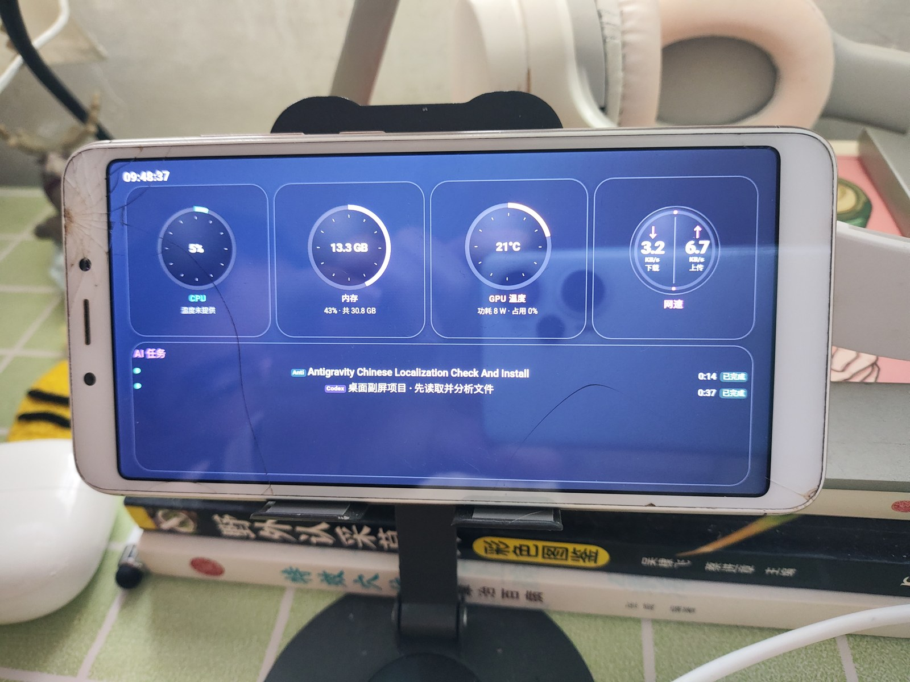

# 手机副屏 AI 监控 · Desk Side Display（本地增强版）

[简体中文](README.md) | [English](README.en.md)

> 基于 [kdwbll/desk-side-display](https://github.com/kdwbll/desk-side-display) 的非官方修改版。原项目采用 MIT 许可证；本仓库保留原始版权声明，并按 MIT 发布。
>
> 本修改版以 Windows 源码方式运行，**不提供预编译 EXE**。它把闲置 Android 手机变成电脑桌面的第二块小屏：显示歌词、硬件监控、AI 任务、时钟、相框和自定义卡片，也可以通过手机触发一些本机操作。



# 给人类看的

## 这个项目适合做什么

很多人手里有闲置的 Android 手机，但电脑桌面已经没有多余的位置放第二台显示器。这个项目把手机变成一块**随电脑启动、通过 USB 或局域网连接的小屏幕**，不需要安装手机 App，也不需要把数据上传到云端。

- **桌面歌词与专辑封面**：电脑播放洛雪音乐、Apple Music 或网易云音乐时，手机显示封面、逐字歌词和播放进度。
- **硬件监控**：显示 CPU 占用、内存、GPU 温度/功耗/占用和实时上下行网速。
- **AI 任务看板**：在底部同时查看 Codex 和 Antigravity 的对话任务、运行时长、子任务进度和完成状态。
- **桌面时钟与相框**：把手机当作床头钟、桌面相框或随时可看的日历。
- **自定义卡片**：在手机横屏上排列天气、音乐、便签、图片、GIF、快捷键等卡片。
- **手机轻操作**：在授权后，可以从手机切歌、暂停、触发预设快捷键、新建便签，或粘贴剪贴板内容。
- **USB 或 Wi-Fi**：USB 通过 ADB 端口转发，适合稳定连接；同一局域网也可直接用浏览器打开。
- **ADB 电源联动**：电脑睡眠时关闭手机屏幕，空闲且没有 AI 任务时降低亮度，唤醒后亮屏并收起非安全锁屏。

项目的所有服务都在本机运行，不依赖云账号，也不会上传硬件读数、剪贴板或对话内容。

## 最实用的场景：把 AI 任务从主屏移到手机

Codex、Antigravity 的任务经常要跑几分钟甚至更久。任务在电脑上运行时，主屏还要用来查资料、写文档、开会或做别的事；频繁切回 AI 窗口看进度会打断手头工作，完全不看又不知道任务是否卡住、什么时候完成。

手机副屏把“看任务”这件事独立出来：

- **电脑主屏可以切到别的页面**：AI 窗口不必留在前台，手机继续显示任务状态；等待生成结果时，可以安心处理其他工作。
- **同时看多个任务**：Codex 与 Antigravity 的任务会合并到同一块看板，每行显示来源、任务标题、已运行时间，以及“执行中”或“已完成”。Antigravity 有任务清单时，还会显示 `已完成数/总数`。看板默认最多显示 6 行；两个来源都有任务时优先各留 3 行。
- **完成状态一眼可见**：任务结束后保留约 2 分钟，抬头就能看到，不用反复切回 Codex 或 Antigravity 确认。
- **长任务和批量任务更省心**：同时开几个对话、让它们分别跑任务时，手机可以持续显示每一行的进度和耗时。
- **只读、低占用**：采集器只读取 Codex 的本地会话文件和 Antigravity 的 SQLite 数据库，不注入、不控制进程，也不读取完整聊天正文；对两个应用的正常使用影响很小。

如果你经常让 AI 跑长任务，这块看板会最有用：电脑继续做别的事，手机放在旁边当一块专用的 AI 任务状态屏。

## 界面概览

### 硬件监控与 AI 任务

监控页顶部是 CPU、内存、GPU 温度和网速四张仪表卡；底部整行是“AI 任务”。每行显示来源标签、标题、耗时和“执行中/已完成”，Antigravity 有任务清单时还会显示 `已完成数/总数`。

### 歌词与专辑流光

背景颜色从专辑封面提取，当前句在右侧居中显示，逐字时间轴会按字高亮。周围歌词支持透明度和模糊度调节。

### Windows 控制面板

在 Windows 控制面板里可以调整显示模式、页面顺序、卡片位置和尺寸、歌词外观、播放源和组件权限。

## 主要功能

| 功能 | 说明 |
| --- | --- |
| 歌词页 | 封面、曲名、逐字歌词、播放进度、上下文歌词和专辑流光背景。 |
| 硬件监控 | CPU、内存、GPU 温度/功耗/占用、实时网速；自动排除常见 VPN/虚拟网卡。 |
| AI 任务 | Codex 与 Antigravity 的本地任务状态、耗时、进度和完成状态。 |
| ADB 电源联动 | USB ADB 连接时，随电脑睡眠、空闲和唤醒调整手机屏幕；不影响局域网模式。 |
| 时钟/相框 | 全屏时钟、日期、图片或 GIF 相框，可设置待机画面。 |
| 自定义页面 | 最多 10 页，每页最多 8 张卡片；支持像素尺寸、拖动、吸附和横屏预览。 |
| 组件动作 | 音乐控制、快捷键、便签、剪贴板历史和自定义 JSON 组件，均需要显式开启权限。 |
| 旧手机兼容 | 针对 Android 9、Via 7.3.3、WebView 80 等旧内核做了 JS/CSS 降级。 |
| USB/局域网 | USB 使用 ADB 转发；局域网使用电脑的 8767 端口。 |

## AI请看这

### 部署（建议交给 AI）

推荐把项目文件夹交给 AI，让 AI 按[使用说明](使用说明.md)的「AI请看这」部分完成环境检查、构建、启动和手机连接。人类只需要确认 UAC、手机 USB 授权和播放器登录。下面保留环境和命令参考，便于 AI 直接执行。

#### 环境要求

- Windows 10/11 x64
- [.NET 9 SDK](https://dotnet.microsoft.com/download/dotnet/9.0)
- 一台 Android 手机（Android 9 及以上均可；旧内核也能使用）
- USB 数据线（USB 模式）或手机与电脑在同一 Wi-Fi（局域网模式）
- 可选：Android Platform-Tools（USB 模式需要 `adb.exe`）

#### 构建和启动（AI 执行）

在项目根目录运行 `一键启动.cmd`。脚本会检查服务是否已运行：已运行则直接打开控制面板，未运行则执行 Release 构建，然后用 `dotnet` 启动。

也可以直接执行：

```powershell
dotnet build DeskSideDisplay.csproj -c Release --nologo
dotnet bin\Release\net9.0-windows10.0.19041.0\DeskSideDisplay.dll --open-control
```

启动后 Windows 控制面板地址是 `http://127.0.0.1:8766/`。

#### USB 连接手机（AI 执行，手机端由人类授权）

1. 让人类在手机开发者选项中开启「USB 调试」，用支持数据传输的线连接电脑，并在手机弹窗中允许这台电脑。
2. 程序或 AI 会执行 `adb reverse tcp:8765 tcp:8765`；成功后让人类在手机浏览器打开 `http://127.0.0.1:8765/`。
3. 让人类把手机横放，轻点画面进入全屏。
4. 如果电脑没有 `adb.exe`，可将 [Android Platform-Tools](https://developer.android.com/tools/releases/platform-tools) 解压到项目根目录的 `.tools/platform-tools/`，或按控制面板提示下载。

#### 局域网连接手机（AI 执行）

手机与电脑连接同一个 Wi-Fi，打开控制面板侧栏显示的「局域网直连」地址，通常是：

```text
http://电脑局域网IP:8767/
```

局域网页面不需要 USB 线，也**没有访问令牌**。只建议在可信家庭/办公网络使用，不要把 8767 端口转发到公网。若 Windows 防火墙拦截，可运行 `Enable-Lan-Firewall.ps1`（需要一次 UAC），或在防火墙中放行 `dotnet.exe` 的 TCP 8767 入站。

### ADB 电源联动

仅在 USB ADB 连接时生效；局域网页面不会控制手机电源或亮度。

- 电脑进入睡眠时发送 `input keyevent 223` 关闭手机屏幕。关机不处理，避免在系统结束进程时留下不可靠的行为。
- 电脑键鼠空闲达到设定时间，且 Codex/Antigravity 没有运行中的任务时，把当前亮度降低到设定百分比；电脑恢复活动、AI 任务开始或电脑唤醒后恢复原亮度和自动亮度模式。
- 电脑从睡眠唤醒后，等待 ADB 恢复，发送 `input keyevent 224` 亮屏，并用 `wm dismiss-keyguard` 收起非安全锁屏。设置了 PIN、图案、密码或指纹时 ADB 无法解锁。
- 控制面板「电源联动」可设置开关、空闲分钟数、降低百分比，以及播放媒体时是否保持亮度。默认空闲 5 分钟、降到 25%，媒体播放时保持亮度。

### 端口与数据位置

| 端口 | 用途 |
| --- | --- |
| `127.0.0.1:8765` | 手机显示页（USB/ADB 转发） |
| `127.0.0.1:8766` | Windows 控制面板 |
| `0.0.0.0:8767` | 局域网手机显示页 |

源码运行时的数据保存在项目目录的 `.data/`，Android 工具放在 `.tools/`。这两个目录以及 `bin/`、`obj/` 都被 `.gitignore` 排除，迁移电脑时可按需复制 `.data/` 保留个人设置。

### AI 任务监控

底部任务卡是本修改版的重点功能之一，数据来源全部是本机文件，只读采集，不控制 Codex 或 Antigravity 的进程。

#### Codex

- 读取 `%USERPROFILE%\.codex\sessions/**/rollout-*.jsonl` 中的 `task_started` / `task_complete` 事件。
- 标题从 `%USERPROFILE%\.codex\session_index.jsonl` 读取；只显示短标题。
- 服务启动时先读文件尾部；如果尾部没有任务事件，会向前分块回溯最近一次任务状态，避免长对话在服务重启后从任务卡消失。
- 运行中显示“执行中”，完成后保留约 2 分钟的“已完成”记录。

#### Antigravity

- 读取 `%USERPROFILE%\.gemini\antigravity\conversation_summaries.db` 中的对话标题、运行状态、步骤数和更新时间。
- 需要子任务进度时，再只读打开 `conversations/<对话ID>.db`，解析 `update_steps` 里的任务清单。
- `RUNNING` / `BUSY` / `CANCELING` 视为执行中，`IDLE` 视为完成；新回合还没有生成新清单时，不显示上一回合的旧进度。
- 使用 SQLite 只读连接，不写 Antigravity 文件，不读取完整聊天正文。

> Antigravity 的本地 SQLite 属于其内部格式，升级后可能改变表结构。读取失败时任务卡会保留上一次快照或降级显示，不会影响副屏主服务。

### 隐私与安全

- 所有功能默认在本机运行，不包含遥测、账号登录或云端同步。
- 局域网显示页 `8767` **没有访问令牌**，同一网段的人可能看到当前任务标题、硬件读数或歌词信息；请只在可信网络使用。
- 不要把 8765/8766/8767 直接暴露到公网，也不要在路由器上做端口转发。
- 剪贴板、快捷键、便签、窗口信息等能力需要用户在控制面板中显式授权，默认关闭。
- Codex 和 Antigravity 的数据采集是只读的；本项目的代码不写这两个应用的文件，也不控制它们的进程。
- `.data/`、`.tools/`、`发布/` 等本机内容不应提交到 Git。

### 兼容性与限制

> **兼容性提醒**：本项目在 Android 9、Via 7.3.3、WebView 80 上验证过，但**不保证适配所有手机和浏览器**。不同手机的屏幕比例、浏览器内核和后台策略可能带来差异。如果遇到其他 bug，可以自行用 AI 修改代码，或联系我：**yykmyykm@163.com**。

- 已在 Android 9、Via 7.3.3、WebView 80 上验证过旧内核显示；现代 Android 浏览器也可使用。
- GPU 温度/功耗/占用优先通过 NVIDIA 驱动自带的 `nvidia-smi` 读取；没有 NVIDIA 时可尝试 LibreHardwareMonitor，缺少读数会显示 `—`。
- CPU 温度助手默认关闭，避免安全软件把自提升级和硬件驱动读取误判；需要时可用 `--cpu-helper` 显式启动并处理 UAC/安全软件信任。
- 网速会自动排除 TAP、TUN、WireGuard、Tailscale、ZeroTier、Hyper-V、VMware、VirtualBox、Docker、WSL 等虚拟网卡；VPN 改变路由时仍建议以实际读数为准。
- Antigravity 任务进度依赖其内部数据库，应用升级后可能需要调整解析逻辑。
- 本修改版不提供预编译 EXE；如需独立发布包，请参考上游项目的发布方式并自行验证许可证和运行时。

### 项目结构

```text
.
  Program.cs                    ASP.NET Core 入口、端口和路由
  DeskSideDisplay.csproj        .NET 9 项目文件
  Services/
    Codex/                      Codex 会话只读采集
    Antigravity/                Antigravity SQLite 只读采集
    Display/                    硬件指标、网络、剪贴板、快捷键等
    Lyrics/                     歌词解析与校准
    Media/                      音乐播放源和洛雪音乐
    Settings/                   页面、组件、外观和本地设置
    Usb/                        ADB 设备识别和端口转发
  wwwroot/
    control/                    Windows 控制面板
    display/                    手机显示页
    shared/                     共享组件、样式和兼容层
  docs/
    screenshots/                项目实拍图（仅 README 封面）
    widget-api.md               自定义组件 JSON 规范
  一键启动.cmd / Start-DeskSideDisplay.ps1  源码启动脚本
  .data/                        本机数据，Git 忽略
  .tools/                       Android Platform-Tools，Git 忽略
```

### 构建与验证

```powershell
dotnet restore DeskSideDisplay.csproj
dotnet build DeskSideDisplay.csproj -c Release --nologo
```

构建后在 Windows 上启动 DLL；服务会监听 8765、8766、8767。首次运行请确认端口未被其他程序占用。

### 使用说明与自定义组件

- [完整使用说明](使用说明.md)：前半部分是「给人类看的」导读和 AI 任务看板介绍，后半部分是「AI请看这」的部署与个性化设置手册。
- [自定义组件规范](docs/widget-api.md)：声明式 JSON 组件、模板、布局、数据源和动作。
- [开发记录](docs/DEVELOPMENT.md)：本修改版的架构、实现要点和已知限制。

### 许可与署名

- 原项目：[kdwbll/desk-side-display](https://github.com/kdwbll/desk-side-display)
- 原项目许可证：MIT，版权声明见 [LICENSE](LICENSE) 和 [NOTICE.md](NOTICE.md)。
- 第三方依赖、参考资料和素材说明见 [THIRD-PARTY-NOTICES.md](THIRD-PARTY-NOTICES.md)。
- 本项目是非官方修改版，不代表原项目作者，也不代表 Codex、Antigravity、NVIDIA、网易云音乐、Apple Music 等产品的官方立场。

欢迎在保留许可证和署名的基础上 Fork、修改和分发。
